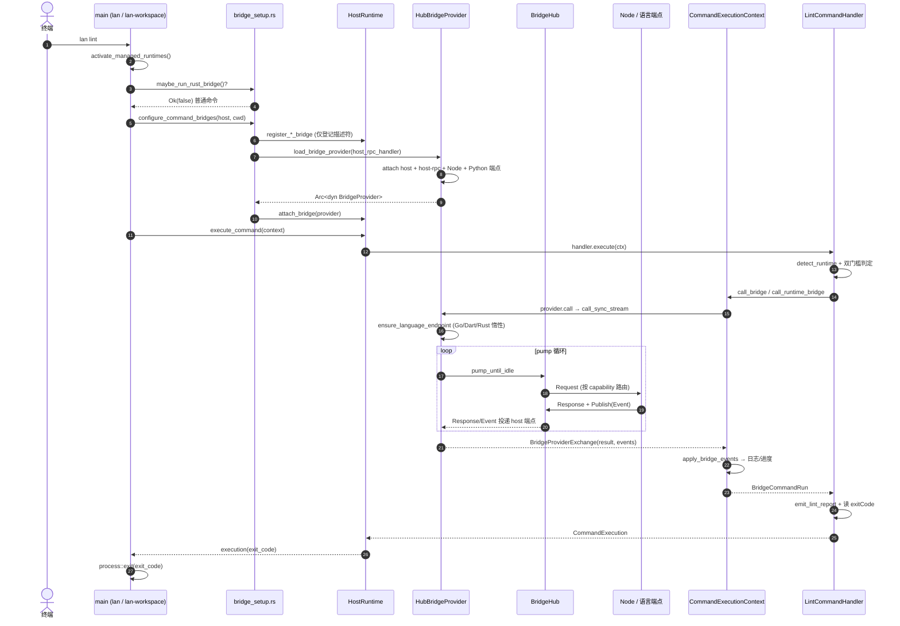

# 01 终端命令主链路：`lan lint` 从敲下回车到进程退出

这篇逐行追踪一条命令的完整轨迹。以 `lan lint`（也可换成 `lan-workspace lint`）为例，看它如何穿过 8 个环节：

```
①入口 → ②B11短路 → ③装配 → ④provider构造 → ⑤handler判定 → ⑥执行dispatch → ⑦路由 → ⑧渲染与退出
```

## 全景时序图



---

## ① 入口：两个二进制，一条汇合线

**总包 `lan`** — `packages/distribution/cli/rust/lania-cli/src/main.rs:31` `main()`：

```rust
 34→    activate_managed_runtimes();                      // 自管运行时（runex）
 40→    if maybe_run_rust_bridge()? { return Ok(()); }    // B11 短路，见 ②
 93→    configure_command_bridges(&mut host, std::path::Path::new(&cwd), true).await?;  // 见 ③
185→        Some(context) => Some(host.execute_command(context).await),                  // 见 ⑤
203→            if exit_code != 0 {
204→                std::process::exit(exit_code);                                       // 见 ⑧
```

**独立二进制 `lan-workspace`** — `packages/commands/workspace/rust/src/bin/lan-workspace.rs:16` `main()`：launcher 把 `workspace lint` 剥成根 spec + `lint` argv，走同一套短路与装配，最后：

```rust
 59→    let code = lania_cli_kit::run_subcommand_entry(&mut host, command_spec, command_argv).await?;
 62→    std::process::exit(code);
```

两条入口在 B11 短路之后完全汇合——区别只在 argv 解析，桥接与执行链完全相同。

---

## ② B11 短路：这个进程是不是 Rust bridge 自己？

**`lania-host/src/bridge_setup.rs:25` `maybe_run_rust_bridge()`**：

```rust
 26→    if !lania_bridge_host::rust_bridge::is_bridge_invocation(env::args_os()) {
 27→        return Ok(false);              // 普通命令：继续装配宿主
 28→    }
 29→    let code = lania_bridge_host::rust_bridge::run_stdio_bridge()?;
 30→    std::process::exit(code);          // 是 bridge 调用：跑协议循环后直接退出
```

判定逻辑在 `lania-rs-bridge/src/lib.rs:75` `is_bridge_invocation()`——只看 `argv[1]` 是否等于隐藏参数 `__lania_rs_bridge`（常量在 `lib.rs:36`）。这就是 Rust 端点"自己再起一个自己"的入口，详见 [03](./03-多语言接入与惰性attach.zh-CN.md) §3。

对普通命令，它返回 `false`，main 继续往下走。

---

## ③ 装配：三件事，把空白宿主变成"总线已就绪"

**`lania-host/src/bridge_setup.rs:45` `configure_command_bridges()`**：

```rust
 52→    let _ = host.register_python_bridge(cwd);      // ① 语言描述符登记（懒加载，不启动进程）
 53→    let _ = host.register_go_bridge(cwd);
 54→    let _ = host.register_dart_bridge(cwd);
 55→    if include_rust_bridge {
 56→        let _ = host.register_rust_bridge(cwd);
 57→    }
 63→    let host_rpc_handler = host.host_rpc_handler();
 64→    let provider = lania_bridge_host::load_bridge_provider(host_rpc_handler)   // ② 装配 Hub provider
 65→        .map_err(|err| anyhow::anyhow!("failed to initialize hub bridge provider: {err}"))?;
 67→    for id in command_language_ids(include_rust_bridge) {
 68→        let _ = provider.register_language(id, BridgeLaunchSpec { ... });      // 声明能力
 69→    }
 77→    host.attach_bridge(provider).await;                                        // ③ 注入 bridge_slot
```

三个要点：

- **① 只是登记，不启动进程**：`register_python_bridge` 等在 `runtime/core.rs:188/201/216/235`，只记一个 `BridgeProgram`/延迟解析函数，供后面 `has_bridge` 做能力可用性判断。
- **② 装配失败直接向上返回 Err**，注释明确写了"不做兼容、不打补丁、不兜底"。
- **③ `attach_bridge`** 在 `runtime/core.rs:92`：`self.bridge_slot.attach(provider);` —— 此后宿主可通过 `bridge_provider()`（`core.rs:98`）拿到它。

`command_language_ids`（`bridge_setup.rs:82`）：总包含 `["python","go","dart","rust"]`，命令子包不含 `rust`。

---

## ④ provider 构造：Hub 第一次"通电"

**`lania-bridge-host/src/provider.rs:362` `load_bridge_provider()`** → 转调 `HubBridgeProvider::new_with_handler()`（`provider.rs:107`），后者做了一串关键动作：

```rust
110→        let mut host = BridgeHost::new()?;
113→        let mut client = host.attach("host");           // 宿主自己的请求端点
117→        client.subscribe("event.*");                   // 订阅所有事件（否则事件收集是死代码）
125→        if let Some(handler) = host_rpc_handler {
126→            let mut rpc_endpoint = host.attach(HOST_RPC_ENDPOINT_ID);
127→            rpc_endpoint.announce_str(&["host.*"], &[]); // 反向 RPC 通配能力
...
137→        let node_command = crate::node_bridge::hub_mode_command(NODE_ENDPOINT_ID)?;
138→        host.attach_command(NODE_ENDPOINT_ID, node_command)?;   // spawn Node hub 子进程
143→        let deadline = std::time::Instant::now() + ANNOUNCE_TIMEOUT;
144→        while !host.hub().is_announced(NODE_ENDPOINT_ID) && ... {
145→            host.pump_until_idle(50);                   // 等 Node announce
...
158→        if host.attach_python_hub(PY_ENDPOINT_ID).is_ok() { ... }  // best-effort attach Python
```

几个细节值得停一下：

- **`host` 端点订阅 `event.*`**（117 行）：这是事件能回到宿主的前提。
- **`host-rpc` 端点声明 `host.*`**（127 行）：Node 才能反过来调用宿主 fs/git/exec，见 [02](./02-多运行时通信机制.zh-CN.md) §4。
- **Node 是核心端点**，构造时就 spawn 并等它 announce（137-145）；Python 也此时 attach（158）；Go / Dart / Rust 留到惰性 attach（见 ⑥）。
- `attach_command` 在 `lania-bridge-host/src/lib.rs:116`：spawn 子进程、piped stdio，把 stdout/stdin 包成 `StdioChannel` 挂进 Hub（131-132 行），并保存 child 供 shutdown 清理。

`hub_mode_command` 在 `lania-node-bridge/src/client.rs:43`，关键就是加环境变量：

```rust
 49→        .env("LANIA_BRIDGE_MODE", "hub")
 53→        .env("LANIA_ENDPOINT_ID", endpoint_id)
```

---

## ⑤ handler 判定：走语言 bridge 还是 JS 簇？

**`lania-host/src/runtime/execute.rs:28` `execute_command()`** → 按 `handler_id` 找到 handler、跑 hook、构造 `CommandExecutionContext`（注入 `bridge_provider`，130 行），调 `handler.execute`（136 行）。

**`commands/workspace/rust/src/lint.rs:87` `LintCommandHandler::execute()`** 的两难选择：

```rust
 98→        if let Some(execution) = run_runtime_bridge(ctx, started).await? {
 99→            return Ok(execution);                          // 非 JS 项目，走语言 bridge
100→        }
102→        let request = build_request(ctx.command(), ctx.request_factory());  // JS 簇
103→        let run = ctx.call_bridge(request).await?;
104→        emit_lint_report(ctx, &run.exchange.response.result, started.elapsed());
```

判定发生在 `lint.rs:197` `run_runtime_bridge()`——两道门槛：

```rust
207→    let kind = lania_host::detect_runtime(std::path::Path::new(&cwd), ctx.project_config(), None);
208→    if !has_lint_bridge(kind) || !ctx.has_bridge(kind) {
209→        return Ok(None);                    // 回落 JS 簇
210→    }
216→    let Ok(client) = ctx.bridge(kind) else { return Ok(None); };
```

- `has_lint_bridge(kind)`（`lint.rs:79`）查 `RUNTIME_LINT_TOOLS` 映射表——Python/Go/Dart/Rust 有 lint 工具，JS 簇为空。
- `ctx.has_bridge(kind)`（`context.rs:265`）查注册表，不启动进程。
- 两道门槛都过，才构造 `lint.{adaptor}` 请求走 `call_runtime_bridge`；否则走 JS 簇的 `lint.run`。**两条路最终都汇入同一个 `provider.call`**（见 ⑥）。

`build_request`（`lint.rs:117`）只是纯数据构造，用 `RequestFactory`：

```rust
181→    let mut request = bridge.lint_run_request(context.cwd.clone(), fix, concurrency);
182→    request.params["mode"] = serde_json::json!(mode);
...
187→    request
```

RequestFactory 的设计见 [04](./04-请求构造与流式调用.zh-CN.md)。

---

## ⑥ 执行 dispatch：`call_bridge` → `call_sync_stream`

**`lania-host/src/execution/bridge_api.rs:27` `call_bridge()`**：

```rust
 91→        let provider = self.bridge_provider().ok_or_else(|| ExecutionError {
                exit_code: EXIT_RUNTIME_ERROR, ... })?;       // 无 provider 直接失败，无回落
 98→        let attempt = tokio::time::timeout(
100→            provider.call(&request.method, request.params.clone()),
101→        ).await;
128→        let events = provider_exchange.events.into_iter().filter_map(...).collect();
158→        self.apply_bridge_events(&request, &exchange);       // 渲染事件（见 ⑧）
209→        self.raise_bridge_error(&request, &exchange.response.error)?;
221→        Ok(BridgeCommandRun { request, exchange, follow_up, interrupted })
```

运行时分支 `call_runtime_bridge`（`bridge_api.rs:236`）几乎同样：走 `provider.call`（256 行）、补 `apply_bridge_events`（302 行），只是返回 `BridgeExchange` 而非 `BridgeCommandRun`，并保留退出码语义。

**`lania-bridge-host/src/provider.rs:194` `call_sync()` → `:201` `call_sync_stream()`** 是全链路的执行泵：

```rust
211→        ensure_language_endpoint(state, method);     // Go/Dart/Rust 惰性 attach
212→        let id = state.client.request(method, params);
216→        let deadline = std::time::Instant::now() + CALL_TIMEOUT;
217→        while std::time::Instant::now() < deadline {
220→            state.host.pump_until_idle(50);                            // ① 请求 → 端点
223→                slot.endpoint.serve_until_idle(&mut *slot.handler, 16); // ② 端点处理请求
226→            state.host.pump_until_idle(50);                            // ③ 响应/事件 → host
228→            while let Some(frame) = state.client.try_recv() {
229→                match frame {
                     BusFrame::Response { id: response_id, .. } => {
                         if response_id == id { outcome = Some((result, error)); }
                     }
                     BusFrame::Event { topic, payload, .. } => on_event(...),
...
246→            if let Some((result, error)) = outcome {
250→                return Ok(result.unwrap_or(Value::Null));
```

这三步 pump 循环是整个 Hub 的"心跳"，每一步的路由细节见 [02](./02-多运行时通信机制.zh-CN.md) §3。

**惰性 attach**（`provider.rs:263` `ensure_language_endpoint`）：按 method 前缀决定要不要在发请求前先 spawn 端点：

```rust
264→    let (id, attach) = if method.starts_with("lint.go-") || ... "build.go" {
268→        (GO_ENDPOINT_ID, BridgeHost::attach_go as ...)
269→    } else if method.starts_with("lint.dart-") || "build.dart" {
270→        (DART_ENDPOINT_ID, BridgeHost::attach_dart as ...)
271→    } else if method == "lint.clippy" || "lint.rust" || "build.rust" {
272→        (RS_ENDPOINT_ID, BridgeHost::attach_rust_hub as ...)
273→    } else { return; }                 // Python/Node 构造时已 attach
280→    state.attached_languages.insert(id.to_string());   // 先标记，失败也不重试
```

---

## ⑦ 路由：Hub 如何把请求送到正确的端点

**`lania-bridge-bus/src/hub.rs:192` `pump_once()`** 每轮从每个通道取一帧，交给 `:241` `route_frame()`：

```rust
248→            self.register_announce(from, provides, subscribes);        // Announce：登记能力
256→            BusFrame::Publish { topic, payload } => self.broadcast(from, &topic, payload),
261→                self.route_request(from, id, capability, params),      // Request：查表路由
263→                self.route_response(id, result, error),                // Response：按 pending 回送
```

`route_request`（`hub.rs:360`）是核心——精确匹配 + 通配回退：

```rust
362→            .capability_index.get(&capability).cloned().unwrap_or_default()   // 精确查
373→      self.capability_index.iter()
375→          .filter(|(pattern, _)| pattern.ends_with('*') && capability_matches(pattern, &capability))  // 通配兜底
383→        if providers.is_empty() { /* 回 E_METHOD_NOT_FOUND */ }
402→        self.pending.insert(id.clone(), from.to_string());  // 记住发起方
405→        if !self.send_to(&provider, frame) { self.pending.take(&id); }
```

`route_response`（`hub.rs:410`）用 `pending.take(&id)` 找回发起方，把响应送回去；`broadcast`（`hub.rs:332`）把 publish 转成 event 投递给所有 `event.*` 订阅者（宿主已订阅）。详见 [02](./02-多运行时通信机制.zh-CN.md) §3。

---

## ⑧ 渲染与退出：事件先消费，错误后抛出

**事件渲染** — `lania-host/src/execution/bridge_helpers/events.rs:29` `apply_bridge_events()` → `:42` `apply_bridge_event()`，把 `event.diag` / `lint_start` / `lint_result` / 进度等映射成日志与进度条副作用：

```rust
 36→        for event in &exchange.events {
 37→            self.apply_bridge_event(request, event);
...
270→            BridgeEventMethod::LintResult => { /* log "{adaptor}: N errors ..." */ }
```

**lint 报告** — `lint.rs:465` `emit_lint_report()` 把 diagnostics 渲染成结构化报告写到 stderr：

```rust
473→    let views = diagnostic_views(result);
485→    let logger = ctx.workflow_services().logger.scoped("command.lint");
492→    for line in renderer.render(&report) {
493→        logger.log(LogLevel::Info, line);
```

**退出码** — 从 `result["exitCode"]` 取，缺省 `EXIT_LINT_FAILED`（`execution/types.rs:18`，值 1）；`complete_bridge`（`bridge_api.rs:422`）把它包进 `CommandExecution::Bridge`，被中断则改 `EXIT_CANCELLED`：

```rust
422→    pub fn complete_bridge(&self, run: BridgeCommandRun, exit_code: i32) -> CommandExecution {
431→            exit_code: if run.interrupted { EXIT_CANCELLED } else { exit_code },
```

最终回到入口：`main.rs:203-205`（总包）或 `lan-workspace.rs:62`（独立包）调用 `std::process::exit(exit_code)`，进程结束。

---

## 一句话总结

`lan lint` 的主链路就是：**入口短路判定 → 一次性装配（登记 + Hub provider + 注入）→ handler 判定语言 → 构造 request → provider 的 pump 循环把请求经 Hub 路由到端点并收回响应与事件 → 渲染事件和报告 → 带退出码退出**。整个过程中，命令层从始至终只持有 `Arc<dyn BridgeProvider>`，不关心对面是 Node、Python 还是 Go。
